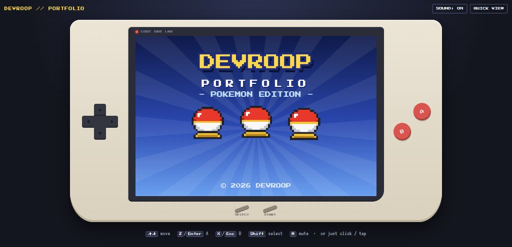
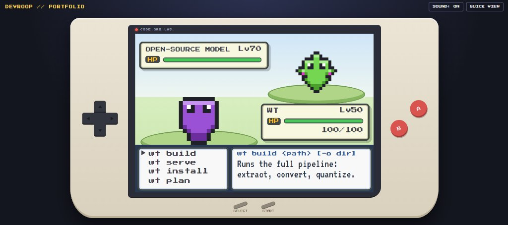

<div align="center">

# 🎮 Devroop Dasgupta // Developer Portfolio
### 🕹️ Retro Handheld RPG Edition · Pokémon Style

[](https://github.com/Mazinho123)
[](https://github.com/Mazinho123)
[](#-features)
[](https://www.linkedin.com/in/devroop-dasgupta-991539319/)
[](https://github.com/Mazinho123)

<br/>



<p align="center">
  <b>A playable, retro handheld-console developer portfolio built with pure HTML5 Canvas, Web Audio API, and vanilla JavaScript.</b><br/>
  <i>No frameworks · No build steps · Zero dependencies · Pure 8-bit nostalgia</i>
</p>

---

</div>

## 📖 About Me

> *"Hi! I'm a developer who loves turning ideas into fast, friendly products. Currently focused on figuring out life and AI to make stuff easier for people around."*

- 📍 **Location:** Bengaluru, India
- ⚡ **Focus:** AI/ML Systems, Agentic Workflows, Backend Pipelines, Computer Vision
- ☕ **Likes:** Coffee, clean code, games, and Pokémon

---

## 🎯 Key Features

- **🕹️ Playable Handheld Console:** Fully interactive retro console with working D-pad, A/B buttons, and screen effects.
- **⚔️ Turn-Based Project Boss Battles:** Experience projects as Pokémon-style RPG battles where CLI commands act as moves to overcome real engineering problems.
- **🔊 Procedural 8-bit Synthesizer:** Real-time retro sound effects generated on the fly via the Web Audio API.
- **🎨 Canvas-Rendered Pixel Art:** Custom sprites, procedural project creatures, and glowing Pokéball-inspired orbs.
- **⚡ Recruiter "Quick View" Mode:** Toggle instant, accessible view anytime (`#quick` or the top-right button) for a clean, resume-style layout.

---

## ⚔️ Featured Projects & Interactive Battles

<div align="center">
  
  <p><i>Turn-based project demo: Deploying <code>wt</code> CLI moves against unquantized model weights!</i></p>
</div>

### 1. [wt - Local Weight Tool](https://github.com/Mazinho123/Weight-normalizer)
> **Stack:** Python · Typer CLI · Docker · llama.cpp · GGUF
- Wraps complex local LLM weights, Docker containers, and port orchestration into a single intuitive CLI.
- Automates model planning, GPU image selection, extraction, conversion, and quantization into `.gguf` format.
- Serves quantized models on port 8080 with an OpenAI-compatible API.
- **Includes playable in-game battle demo!**

### 2. [Better-RAG](https://github.com/Mazinho123/Better-RAG-)
> **Stack:** Python · FastAPI · ChromaDB · BM25 · Groq / Ollama
- Production-grade agentic RAG pipeline processing PDF, DOCX, HTML, and TXT files.
- Hybrid search pairing Vector Embeddings and BM25 via Reciprocal Rank Fusion (RRF) with Cross-Encoder reranking.
- Router, multi-step query planner, and an LLM judge verifying citation evidence before answering.

### 3. [Gaze Deviation & Proctoring Detection](https://github.com/Mazinho123/Gaze_deviation_detection-)
> **Stack:** Python · OpenCV · MediaPipe · Computer Vision
- Real-time online exam proctoring proof-of-concept tracking head pose, sustained eye closure, and downward gaze.
- Dynamic 11-feature sliding-window pupil, blink, and fixation analysis to detect suspicious behavior.
- Adaptive thresholding calibrated to camera resolution (720p/480p) to minimize false positives.

---

## 🎮 Controls

You can interact using either your keyboard or the on-screen tactile buttons:

| Action | Keyboard | Handheld |
| :--- | :--- | :--- |
| **Move / Navigate** | <kbd>Arrow Keys</kbd> or <kbd>W</kbd> <kbd>A</kbd> <kbd>S</kbd> <kbd>D</kbd> | **D-Pad** |
| **Confirm / Interact** | <kbd>Z</kbd> or <kbd>Enter</kbd> | **A Button** |
| **Back / Cancel** | <kbd>X</kbd> or <kbd>Esc</kbd> | **B Button** |
| **Trainer Card / Contact** | <kbd>Shift</kbd> | **SELECT** |
| **Start Game** | <kbd>Enter</kbd> | **START** |
| **Toggle Mute** | <kbd>M</kbd> | Topbar sound pill |

---

## 🛠️ Tech Stack

```text
Frontend:   Vanilla JavaScript (ES6+), HTML5 Canvas, CSS3
Audio:      Web Audio API (Procedural 8-bit sound chip synthesis)
Assets:     Custom pixel art matrices & procedural sprite generation
Backend/AI: Python, FastAPI, Docker, llama.cpp, ChromaDB, MediaPipe, OpenCV
```

---

## 🚀 Running Locally

Because this project is built entirely on vanilla web standards, there are **no dependencies to install** and **no build steps**:

### Option 1: Open Directly
Double-click `index.html` or open it in your web browser.

### Option 2: Run a Local Server (Recommended)
```bash
# Using Python
python -m http.server 8000

# Or using Node.js
npx serve .
```
Then navigate to `http://localhost:8000` in your browser.

---

## 📬 Contact & Connect

- **Email:** [dasguptadevroop@gmail.com](mailto:dasguptadevroop@gmail.com)
- **LinkedIn:** [linkedin.com/in/devroop-dasgupta-991539319](https://www.linkedin.com/in/devroop-dasgupta-991539319/)
- **GitHub:** [@Mazinho123](https://github.com/Mazinho123)

---

<div align="center">
  <sub>Built with ❤️ and 8-bit pixels · © 2026 Devroop</sub>
</div>
